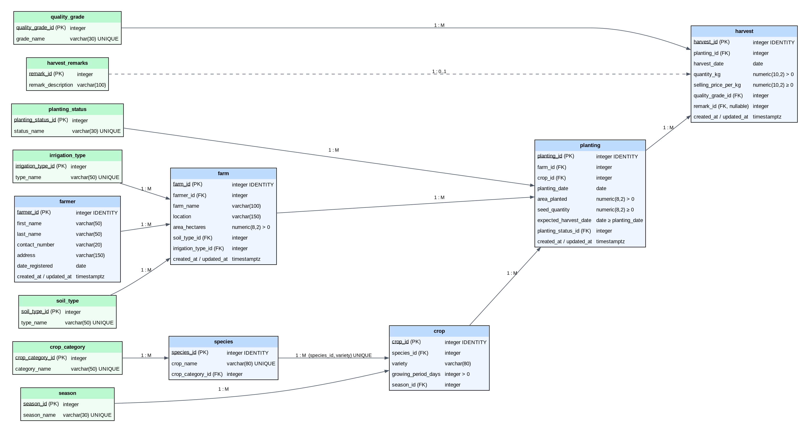

# Entity-Relationship Diagram (ERD)



*A larger vector version is available at [`erd.svg`](erd.svg); the Graphviz source is [`erd.dot`](erd.dot).*

## Entities and Keys

### `crop_category` (lookup)
- **crop_category_id** (PK)
- category_name — unique, e.g. Cereal, Vegetable, Fruit, Legume, Root Crop

### `season` (lookup)
- **season_id** (PK)
- season_name — unique, e.g. Wet Season, Dry Season, Year Round

### `soil_type` (lookup)
- **soil_type_id** (PK)
- type_name — unique, e.g. Loam, Clay Loam, Sandy Loam, Clay

### `irrigation_type` (lookup)
- **irrigation_type_id** (PK)
- type_name — unique, e.g. Rainfed, Irrigated, Drip Irrigation

### `planting_status` (lookup)
- **planting_status_id** (PK)
- status_name — unique, e.g. Growing, Harvested, Failed

### `quality_grade` (lookup)
- **quality_grade_id** (PK)
- grade_name — unique, e.g. Grade A, Grade B, Grade C

### `harvest_remarks` (lookup)
- **remark_id** (PK)
- remark_description

### `species`
- **species_id** (PK, IDENTITY)
- **crop_category_id** (FK → `crop_category.crop_category_id`)
- crop_name — unique (Rice, Corn, Tomato, …)

### `crop` (a variety of a species)
- **crop_id** (PK, IDENTITY)
- **species_id** (FK → `species.species_id`)
- **season_id** (FK → `season.season_id`)
- variety, growing_period_days
- UNIQUE (species_id, variety)

### `farmer`
- **farmer_id** (PK, IDENTITY)
- first_name, last_name, contact_number, address, date_registered
- created_at, updated_at

### `farm`
- **farm_id** (PK, IDENTITY)
- **farmer_id** (FK → `farmer.farmer_id`)
- **soil_type_id** (FK → `soil_type.soil_type_id`)
- **irrigation_type_id** (FK → `irrigation_type.irrigation_type_id`)
- farm_name, location, area_hectares
- created_at, updated_at

### `planting`
- **planting_id** (PK, IDENTITY)
- **farm_id** (FK → `farm.farm_id`)
- **crop_id** (FK → `crop.crop_id`)
- **planting_status_id** (FK → `planting_status.planting_status_id`)
- planting_date, area_planted, seed_quantity, expected_harvest_date
- created_at, updated_at

### `harvest`
- **harvest_id** (PK, IDENTITY)
- **planting_id** (FK → `planting.planting_id`)
- **quality_grade_id** (FK → `quality_grade.quality_grade_id`)
- **remark_id** (FK → `harvest_remarks.remark_id`, nullable)
- harvest_date, quantity_kg, selling_price_per_kg
- created_at, updated_at

## Relationships and Cardinalities

```
crop_category     (1) ──< (M) species
species           (1) ──< (M) crop
season            (1) ──< (M) crop
farmer            (1) ──< (M) farm
soil_type         (1) ──< (M) farm
irrigation_type   (1) ──< (M) farm
farm              (1) ──< (M) planting
crop              (1) ──< (M) planting
planting_status   (1) ──< (M) planting
planting          (1) ──< (M) harvest
quality_grade     (1) ──< (M) harvest
harvest_remarks   (1) ──< (0..1) harvest    (optional FK)
```

Reading the notation: one parent row relates to zero or many child rows, e.g. one
farmer owns zero or many farms, while each farm belongs to exactly one farmer.

## Design Notes

- **Surrogate primary keys.** Every core table uses an integer IDENTITY
  primary key. Lookup tables use short, explicit integer IDs so reference data
  is stable across the SQLite and Supabase builds.
- **Dropdowns store IDs.** Soil, irrigation, category, season, status, grade and
  remark dropdowns submit the lookup ID; the UI joins the lookup table to show
  the descriptive label.
- **Variety vs. species.** `species` holds the crop name and category;
  `crop` holds a plantable variety of that species together with its growing
  period and recommended season. This avoids storing the crop name and
  category again on every variety row.
- **Referential integrity.** Every foreign key is enforced. Deletion guards in
  the application block removing a farmer with farms, a farm with plantings, a
  crop with plantings, or a planting with harvests.
- **Duplicate remarks removed.** Harvest remarks are stored once, in
  `harvest_remarks`, and referenced by `remark_id`. There is no free-text copy
  of the same remark in `harvest`.
- **Audit fields.** `created_at` and `updated_at` are present on `farmer`,
  `farm`, `planting` and `harvest`.
- **RLS.** Row Level Security is enabled on all tables. Lookup and reference
  tables are read-only; the seeded permissive policies are for the school demo
  and should be tightened for production.
